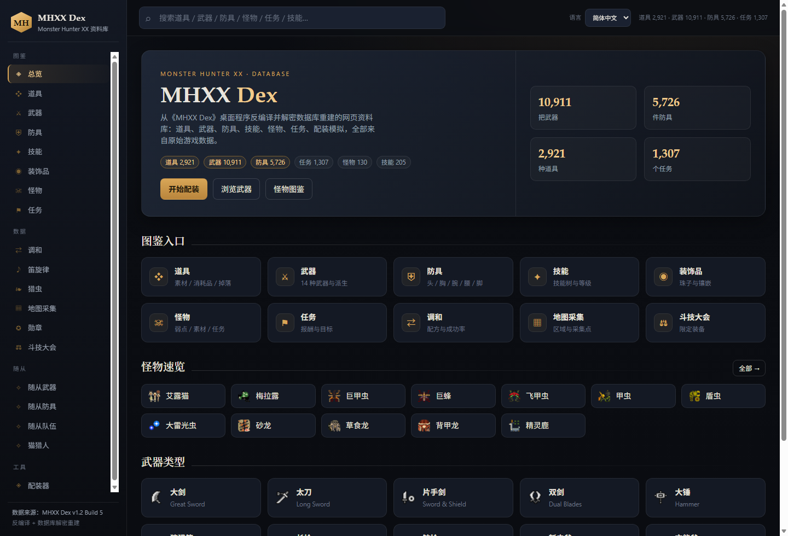
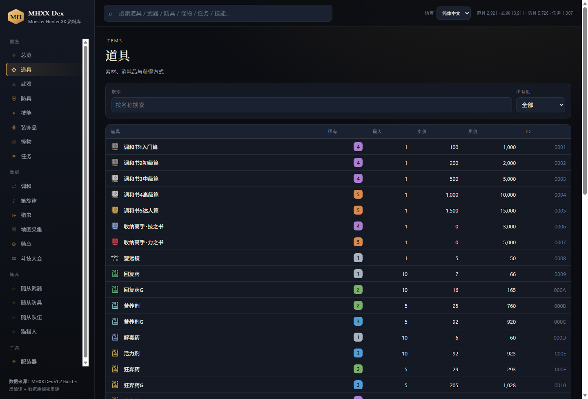
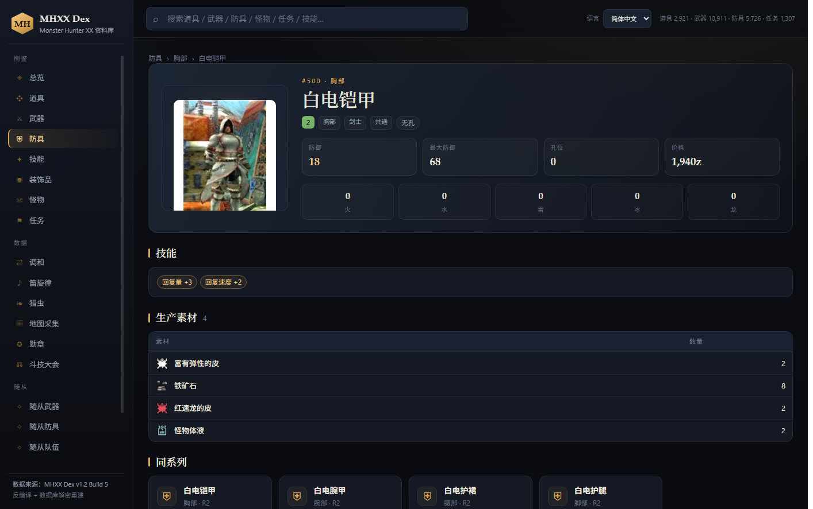
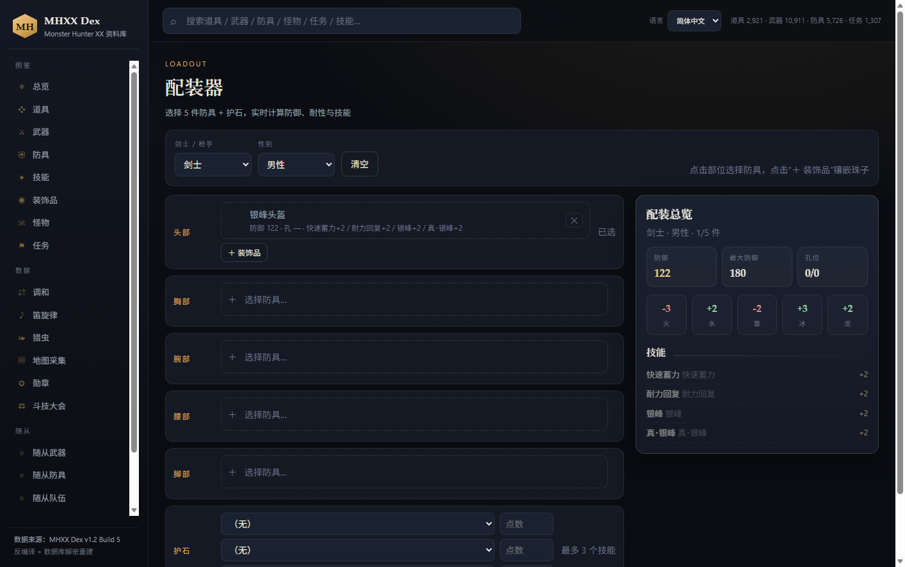
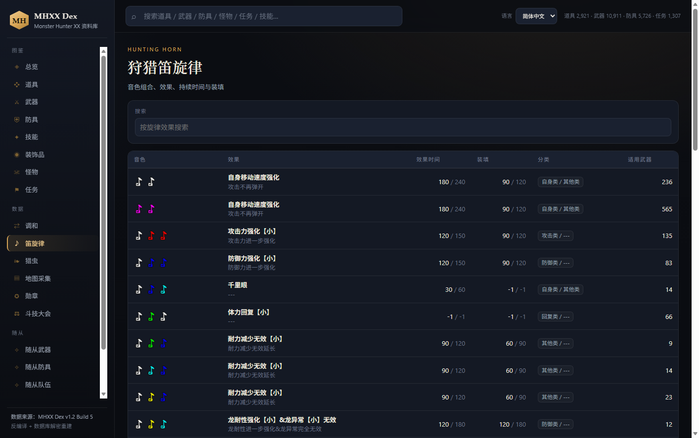
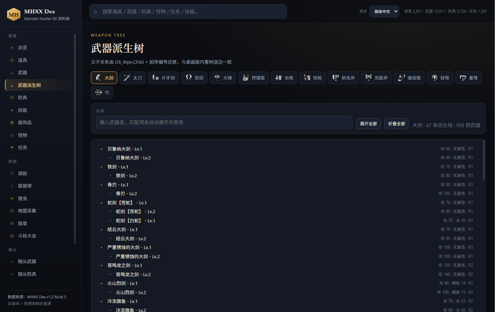
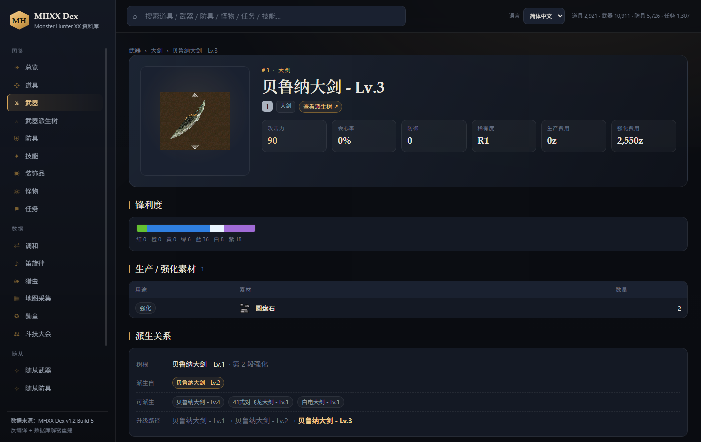

# MHXX Dex Web

把《MHXX Dex》桌面程序（`MHXX Dex.exe` + 加密 SQLite 库）反编译、解密后重建的网页资料库。
**零运行时依赖**：只用 Node.js 24 内置的 `node:sqlite` 与 `node:http`，前端是原生 JavaScript + CSS，无需 npm install，也不需要构建步骤。



---

## 快速开始

```powershell
cd webapp
node server/server.js        # 或双击 start.cmd
# 浏览器打开 http://127.0.0.1:8787/
```

> 要求 Node.js ≥ 24（内置 `node:sqlite` 与原生 `WebSocket`）。端口可用 `PORT` 环境变量覆盖。

---

## 功能

| 模块 | 内容 |
| --- | --- |
| 首页 | 数据总览、图鉴入口、怪物/武器类型速览 |
| 道具 | 2,921 种道具；稀有度/价格；详情含怪物掉落、地图采集、任务报酬、调和配方、武器/防具/装饰品素材、山菜爷交换、随从队伍 |
| 武器图鉴 | 10,911 把、14 种类型；可切换派生图、生产列表、强化列表和全部武器；选中武器后查看立绘、素材、费用和属性 |
| 弩弹种 | 轻弩、重弩的信息栏显示装填数、速射、蹲射、内藏弹总数，以及需要技能追加的弹种 |
| 武器派生图 | 794 条派生线、10,117 条父子边，最深 17 段；支持路线跳转、按名称高亮和方向键选择，另有可展开的文字树 |
| 防具 | 5,726 件，按 1,260 个系列分组；三栏筛选、可折叠长列表、整套技能点合计及单件素材和耐性 |
| 技能 | 205 个技能树；等级阈值、说明；提供该技能的防具与装饰品 |
| 装饰品 | 275 种珠子；孔位、价格、技能、素材 |
| 怪物 | 93 只大型、36 只小型；分栏查看部位示意图、肉质、状态和陷阱、任务及掉率；阁螳螂支持单独查看本体和机甲 |
| 任务 | 1,307 个；左侧搜索和组合筛选，右侧查看目标、报酬、怪物、前置、受注和解锁资料 |
| 调和 / 笛旋律 / 猎虫 / 地图采集 / 勋章 / 斗技大会 / 猫猎人 | 原始数据表重建 |
| 随从 | 武器、防具三栏图鉴；随从队伍按地区、等级、来源图标和道具查询全部 1,396 条奖励 |
| 地图与交换 | 27 张原版区域图、按区域和等级筛选采集点、540 条山菜爷交换记录 |
| 配装器 | 支持按目标技能自动搜索和手动配装；可录入护石、设置武器孔位、收藏和重命名配装 |
| 全局搜索 | 道具/武器/防具/怪物/任务/技能 六类聚合搜索 |
| 多语言 | 9 种语言的数据名切换（EN/简中/繁中/日/韩/德/法/意/西），与桌面版一致；界面保持中文 |

<table>
<tr><td></td><td></td></tr>
<tr><td></td><td></td></tr>
<tr><td></td><td></td></tr>
</table>

---

## 技术栈

- **后端**：Node.js 24 + `node:sqlite`（只读打开解密库）+ `node:http`，单文件 `server/server.js`
- **前端**：原生 JS（hash 路由 + 模板字符串渲染）、原生 CSS（暗色 MH 风格、响应式）
- **数据**：`data/mhxx_dex.sqlite`（由 `Decompiled/database/mhxx_dex_decrypted.sqlite` 复制）
- **图片**：从原程序集资源中导出的 8,085 张图标/装备图，置于 `public/icons/`

没有框架、没有打包器、没有第三方依赖，便于修改和长期维护。

---

## 目录结构

```
webapp/
├─ server/
│  └─ server.js          HTTP 服务 + JSON API + 静态文件 + 图标解析
├─ public/
│  ├─ index.html         应用外壳（侧栏、顶栏、搜索）
│  ├─ app.js             路由、列表/详情渲染、配装器
│  ├─ style.css          主题与布局
│  └─ icons/             8,085 张图片（<name>.png / <name>.jpg）
├─ data/
│  └─ mhxx_dex.sqlite    解密后的数据库（84 张表，13.7 MB）
├─ docs/                 截图
├─ start.cmd             一键启动（Windows）
└─ package.json          scripts.start
```

---

## API 一览

所有接口都支持 `lang=0..8` 参数（数据名称语言，默认 1 = 简体中文）。

| 方法 | 路径 | 说明 |
| --- | --- | --- |
| GET | `/api/meta` | 计数、语言、武器类型、部位、任务等级/类型（按语言） |
| GET | `/api/items?q&rarity&page` | 道具分页列表 |
| GET | `/api/items/:id` | 道具详情 + 全部获取途径 |
| GET | `/api/weapons?q&type&rarity&sort&page&recipe` | 武器列表，`recipe=production` 筛选可生产武器，`recipe=upgrade` 筛选可强化获得的武器 |
| GET | `/api/weapons/tree?type=` | 某类武器的完整派生树（嵌套结构） |
| GET | `/api/weapons/:id` | 武器详情（锋利度解码、素材、弹药、旋律、派生关系） |
| GET | `/api/armor?q&part&borg&morf&slot&rarity&page` | 防具列表 |
| GET | `/api/armor/:id` | 防具详情 + 技能 + 素材 + 同系列 |
| GET | `/api/armor/sets?q&part&borg&morf&slot&rarity&skill` | 全部匹配的套装与整套技能点。按单件筛选时，合计仍使用整套部件。 |
| GET | `/api/skills?q&page`、`/api/skills/:id` | 技能树与等级 |
| GET | `/api/jewels?q&slot&page`、`/api/jewels/:id` | 装饰品 |
| GET | `/api/quests?q&group&lv&type&key&supplement&page`、`/api/quests/:id` | 任务、报酬和解锁资料 |
| GET | `/api/locations/:id`、`/api/locations/trades` | 地图采集与山菜爷交换 |
| GET | `/api/monsters?q&kind&page`、`/api/monsters/:id` | 分类、原版部位图、肉质、耐性、陷阱和各等级掉率 |
| GET | `/api/combos`、`/api/horns`、`/api/kinsects`、`/api/palico/*`、`/api/arena`、`/api/locations`、`/api/awards`、`/api/hfh` | 其余数据表 |
| GET | `/api/search?q` | 六类聚合搜索 |
| GET | `/api/set/armor?part&borg&morf`、`/api/set/jewels`、`/api/set/skills` | 配装器选项 |
| POST | `/api/set/compute` | 配装计算（部位 + 装饰品 + 护石 → 总防御/耐性/技能） |
| POST | `/api/set/search` | 搜索满足所选技能等级的五件防具、护石和装饰品位置 |

---

## 任务资料来源

任务名称、星级、目标和结算报酬来自原版 MHXX Dex。前置、受注、狩技、食材及其他解锁信息取自 [jestar719/mhgu 随附的 MHXX 网页资料](https://github.com/jestar719/mhgu/tree/fb8878ea2e0ff4c2848d7d9599ceb2f1279700ff/app/src/main/assets/mhxx)，按星级、译名、任务目标和报酬等信息匹配。任务详情链接到对应的来源页面。没有把握的任务不会附上补充资料，只有解锁类别的条目会注明来源未列具体项目。

`data/quest-reference.json` 随网页分发，本地使用无需联网。更新时运行 `uv run --script tools/import-quest-reference.py <mhgu 仓库目录>`。

## 配装器算法

自动搜索先跳过已排除的防具，再为每件装备生成孔位允许的装饰品组合，按目标技能点数合并等效选项。搜索逐件匹配技能门槛，按剩余部位的最高可达点数剪枝，并计入身体系统加倍对胸甲和其中装饰品的影响。每次最多列出 100 组，按所找到组合的最大防御排序。达到搜索时限时会说明。护石按技能点和孔位显示。护石、排除清单和收藏保存在当前浏览器。

手动配装：

1. 五件防具的技能点来自 `DB_SklTreetoAmr`，装饰品来自 `DB_Jew`（最多两个技能），护石由用户手填；
2. 按技能树累加点数；
3. 用 `DB_Skl` 的阈值表匹配等级：正技能取 `点数 ≥ Pt` 的最高档，负技能取 `点数 ≤ Pt` 的最强档；
4. 防御/最大防御/五属性耐性直接求和，孔位按防具 `Slot` 统计、按珠子 `Slot` 计算占用。

---

## 武器派生树如何还原

数据库没有 `Parent_ID` 之类的父子列，树结构由两点共同表达：

1. `DB_Wpn.Child` = **直接子武器数量**（取值 0–5），而不是父指针；
2. 武器行按 `Wpn_ID` 升序存储，顺序正好是树的**前序（preorder）**（每个类型内部连续）。

因此按顺序消费节点、每个节点再递归读取 `Child` 个子节点即可精确还原整片森林：

```js
let i = 0;
function build() {
  const node = rows[i++];
  node.children = [];
  for (let k = 0; k < node.Child; k++) node.children.push(build());
  return node;
}
```

验证方式：原程序 `FrmWeapon` 里用 10,911 行硬编码的 `TreeNode` 构造保存了同一棵树（`u1701_13()`），
把它解析出来与数据库重建结果逐边对比 —— **10,117 条边、794 个根、0 处不一致**。

另外 `DB_ItmtoWpn.Type='U'` 的 28,636 行是「升级所需素材」，不含上级武器 ID，不能用来连边。

## 图片资源

全部来自原程序集（`MHXX Dex.exe` 的 `MHXX_Dex.Resource Image`）与图片库程序集（`System.Data.SQLite.EF6.dll` 的 `Image_MHXX_ImgFile.Resource *`）：

| 前缀 | 内容 |
| --- | --- |
| `Itm_0001` | 道具图标 |
| `Mon_S_001` / `Mon_B_001` | 怪物小/大图标 |
| `MonPart_037` 等 | 桌面版原始分辨率的编号肉质示意图，共 89 张 |
| `Wpn_0101` | 武器类型图标（类型 2 位 + 序号 2 位） |
| `AmrImg_0001_M/F` | 防具套装立绘（男/女，已压缩为 ≤200px JPEG） |
| `two130`、`swo001`、`bow001` … | 武器立绘（来自 `DB_Wpn.ImgFile`） |
| `HHNote_1..8`、`Trap_1..5`、`Stat_06..13`、`QstIcon_1..8` | 音符/陷阱/状态/任务图标 |

图标统一通过 `/icons/<name>` 访问，服务端自动解析 `.png`/`.jpg`，缺失时回退到 `blank16`。

---

## 与桌面原版的差异

- **重新实现**：原程序是 WinForms 客户端 + 原生 `winbind.dll` 配装检索；网页版用 JS 重写了浏览、搜索、武器派生树与配装计算，不依赖任何原生模块。
- **武器树**：原版把 10,911 个 `TreeNode` 硬编码进程序集；网页版改为从 `DB_Wpn.Child` + 前序编号实时重建，逐边验证与原版一致。
- **配装检索**：网页版使用 Node.js 工作线程搜索技能组合，护石、排除清单和收藏存于浏览器。
- **未实现**：我的护石 CSV 导入/导出、更新检查。
- **状态与陷阱**：耐性和持续时间取自原库。名称通过桌面版图标及 MHXX/MHGU 资料表对照补齐。原版缺少 `Stat_12` 跳跃图标，该行显示名称。
- **装备立绘**：原图为大尺寸 PNG，为控制体积已缩放到 ≤200px 并转 JPEG（图标本身保持原样）。
- **数据只读**：所有浏览接口只读，不写入数据库。

---

## 数据与版权

数据、名称、图标版权归《怪物猎人 XX》及原工具作者（Ping / pingtendo）所有；
本项目仅作为反编译学习与个人查阅使用，请勿用于商业用途或再分发数据副本。
